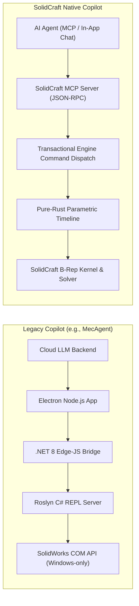
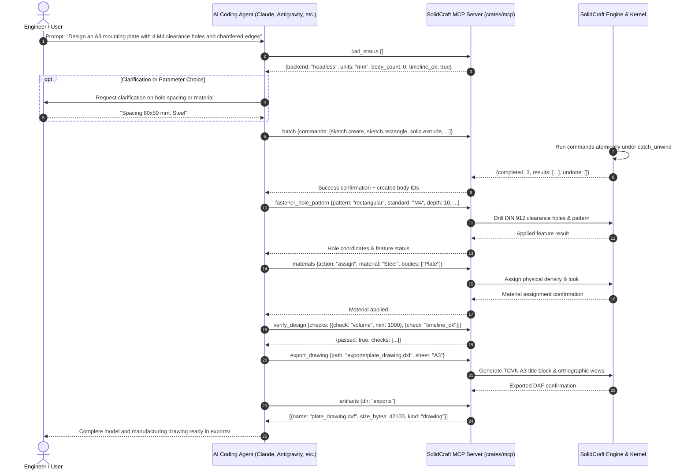

# CAD AI Copilot Architecture: SolidCraft & MecAgent Analysis

This document outlines the architecture of AI-assisted Computer-Aided Design (CAD) copilots, referencing the reverse-engineering analysis of **MecAgent v2.0.7** (a commercial AI assistant for Dassault Systèmes SolidWorks) and detailing how **SolidCraft** adopts, refines, and implements these architectural patterns in an independent, clean-room, pure-Rust parametric CAD platform.

---

## 1. Executive Summary & Design Philosophy

AI Copilots for mechanical CAD bridge natural language intent with geometric modeling kernels. While legacy systems operate as multi-layer wrappers around commercial closed-source CAD software via COM interop and dynamic scripting, modern CAD architectures require:

1. **Deterministic Execution:** Modeling actions must be structured as transactional commands with predictable, undoable state transitions.
2. **Crash Resilience:** The CAD kernel and host process must never crash or panic on unexpected model topologies or hostile inputs.
3. **Local-First & Cross-Platform Operation:** AI capabilities must run safely on Linux, macOS, and Windows without vendor lock-in or uncontained OS access.
4. **Clean-Room Independence:** No proprietary APIs, closed SDKs, or restrictive (GPL/LGPL/commercial) code are linked or copied.

---

## 2. Comparative Architecture Overview

| Dimension | MecAgent (Reverse-Engineered v2.0.7) | SolidCraft Native Architecture |
|---|---|---|
| **Core CAD Engine** | Proprietary Commercial CAD (`SLDWORKS.exe`) | Open-source, pure-Rust B-Rep kernel (`truck`-guarded) |
| **Language Stack** | TypeScript, React 19, C# (.NET 8), Roslyn Scripting | 100% Rust (UI: `egui`/`wgpu`, Engine, Kernel) |
| **Agent Interface** | Cloud WebSocket (Laravel Reverb) + HTTP REST | Model Context Protocol (MCP, stdio JSON-RPC 2.0) + Local Control Protocol (TCP JSON lines) |
| **Execution Model** | Out-of-process C# dynamic compilation (`ReplWindow.exe`) | Structured, validated JSON commands (`engine.execute`, `batch`) |
| **Safety & Undo** | Custom C# COM transaction wrapping | First-class engine undo/redo stack; atomic `batch` rollback on failure |
| **File Sandbox** | Unrestricted filesystem access via .NET standard library | Strict virtual filesystem (`vfs::PathScope`) limiting I/O to allowed folders |
| **Human-in-the-Loop** | WebSocket operations: `cad.confirm`, `user.ask` | In-app Agent Chat permissions (`ask`, `edits`, `all`) & `ui.confirm` |
| **Platform Support** | Windows only (x86_64, requires SolidWorks license) | Windows, Linux, macOS, and WebAssembly (`wasm32-unknown-unknown`) |

---

## 3. Turn-by-Turn Agent Execution Lifecycle

MecAgent coordinates turn-by-turn CAD modifications through cloud WebSocket operations (`run.acquire`, `cad.execute`, `cad.confirm`, `user.ask`, `cad.artifacts`, `run.release`). SolidCraft implements the same end-to-end lifecycle locally and safely via MCP tools and engine commands:

### Lifecycle Stage Mapping:

1. **Session Coordination (`run.acquire` / `run.release`):**
   - *MecAgent:* Acquires session lock over WebSocket so background threads do not mutate SolidWorks simultaneously.
   - *SolidCraft:* Managed by MCP session lifetime and the control channel's authentication token (`docs/control-protocol.md#token`). In bridged mode, requests execute on the UI thread between frames, avoiding concurrent modification.
2. **Atomic Execution (`cad.execute`):**
   - *MecAgent:* Compiles C# snippets with Roslyn on the fly; COM exceptions must be caught manually.
   - *SolidCraft:* Uses `batch` and `execute` MCP tools. Commands run through `Session::execute` under `catch_unwind`. If any step fails, the batch automatically rolls back preceding steps (`rollback: true`), restoring the design state.
3. **Session Status & Health (`cad.status` / `cad_status`):**
   - *MecAgent:* Periodic HTTP `/health` and `cad.status` polls to check PID, bridge status, and COM connection.
   - *SolidCraft:* The `cad_status` MCP tool provides an instant, lightweight report (backend mode, document name, units, feature/body counts, active sketch, undo depth, and timeline error status) without the heavy cost of body tessellation.
4. **Artifacts Discovery (`cad.artifacts` / `artifacts`):**
   - *MecAgent:* Scans staging directories for created `.SLDPRT`, `.SLDDRW`, and `.STEP` files.
   - *SolidCraft:* The `artifacts` MCP tool scans allowed workspace folders for generated CAD artifacts (`.solidcraft`, `.step`, `.dxf`, `.stl`, `.3mf`, `.obj`, `.urdf`, `.png`), reporting file sizes, formats, and modification timestamps within the security sandbox.
5. **Human-in-the-Loop Confirmation (`cad.confirm` / `user.ask`):**
   - *MecAgent:* Cloud requests desktop client to popup an approval modal or parameter form.
   - *SolidCraft:* Built directly into the in-app Agent Chat (`docs/agent-chat.md`) with permission levels (`ask`, `edits`, `all`), approval chips, and interactive parameter prompts.

---

## 4. CAD Agent Capability Matrix

MecAgent defines over 80 specific C# methods in `MecAgent.MCPMethods`. SolidCraft covers this functional taxonomy through modular engine commands and high-level MCP tools:

| Functional Area | MecAgent C# Tools | SolidCraft Native Equivalents |
|---|---|---|
| **2D/3D Sketching** | `createNewSketch`, `createSketchLine`, `createSketchCircle`, `createSketchRectangle`, `createSketchArc`, `createSketchSpline`, `createSketchPoint`, `exitSketch`, `getAvailableSketchPlanes` | `sketch.create`, `sketch.line`, `sketch.circle.*`, `sketch.rectangle.*`, `sketch.arc.*`, `sketch.spline`, `sketch.point`, `sketch.dimension`, `sketch.constraint.*`, `sketch.finish` |
| **Solid Features** | `createExtrusion`, `createCutExtrusion`, `createRevolve`, `createHoleWizard`, `createFilletOnSelectedEdges`, `createChamferOnSelected`, `modifyFeatureParameter` | `solid.extrude`, `solid.revolve`, `solid.fillet`, `solid.chamfer`, `solid.hole`, `solid.shell`, `solid.pattern.*`, `solid.mirror`, `fastener_metric_hole`, `fastener_hole_pattern`, `set_parameter` |
| **Assemblies & Kinematics** | `enumerateAssemblyComponents`, `enumerateMates`, `activatePartEditInAssembly`, `exitAssemblyEditContext`, `renamePartInAssembly` | `component.new`, `occurrence.move`, `joint.create` (rigid, revolute, slider, cylindrical, pin-slot, planar, ball), `joint.drive`, `motion.study`, `inspect.interference` |
| **Drawings & 2D Sheets** | `executeDrawingGenerator`, `PrintDrawingFeatureTree` | `export_drawing` (ISO/TCVN A0–A4 title block & 1st/3rd angle views), `export_views` (orthographic DXF with hidden-line removal) |
| **Materials & Mass** | `listAvailableMaterials`, `applyMaterialToPart` | `materials` MCP tool (`action: "list"` / `"assign"`), `material.create`, `material.assign`, `appearance.assign`, `material.properties.validate` |
| **Inspection & DFM** | `measureDistanceBetweenSelected`, `measureAngleBetweenSelected`, `measureRadiusOfSelected` | `measure` (volume, area, centroid, bounding box, diameters, centre distances), `find_faces`, `body_topology`, `verify_design`, `dfm_clearance_check`, `fdm_print_estimate` |
| **Visual Capture & Files** | `capture_solidworks_window`, `getFeatureTreeJson`, `exportModelToStep` | `screenshot` (window or GPU/CPU model render), `cad_status`, `artifacts`, `export` (STEP, 3MF, STL, OBJ, URDF), `open`, `save` |

---

## 5. Security, Sandboxing, and Clean-Room Architecture

### Virtual Filesystem (VFS) Path Confinement
Unlike tools that execute arbitrary scripts or interact directly with Windows COM servers, SolidCraft enforces strict path containment through `solidcraft_engine::io::vfs::PathScope`:
- Only directories explicitly granted via `--allow-path`, the active design directory, and the private MCP scratch directory may be read, written, or scanned.
- Attempts to escape via directory traversal (`..`), symlinks, UNC network shares, or device paths (`CON`, `NUL`, `COM1`) are rejected before any filesystem operations occur.

### Panic-Free Execution Guarantee
Following SolidCraft core tenets:
- Non-test code forbids `unwrap()`, `expect()`, `panic!`, `unimplemented!`, `todo!`, and `unsafe`.
- All operations return `Result<T, EngineError>`.
- Kernel booleans and blends executed through `truck` are protected by `solidcraft_kernel::guard`.
- Hostile agent inputs (out-of-bounds coordinates, non-finite floats, huge batch requests) are bounded and rejected cleanly without corrupting memory or the undo stack.

---

## 6. Conclusion

By abstracting CAD operations into an atomic command registry (`crates/engine`), exposing them through standardized JSON-RPC protocols (`crates/mcp`), and reinforcing operations with self-checking verification tools (`verify_design`, `cad_status`, `artifacts`), SolidCraft achieves the functional copilot capabilities demonstrated in hybrid assistants like MecAgent, while preserving memory safety, clean-room independence, and cross-platform flexibility.
